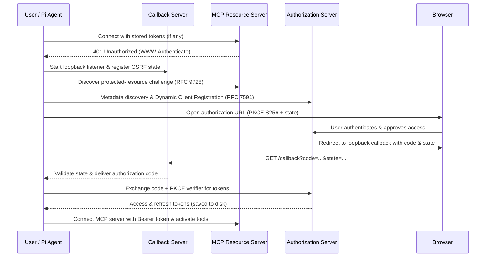

# OAuth 2.1 Authentication

pi-mcp-extension supports OAuth 2.1 with PKCE for MCP servers that require browser-based authentication (e.g., DeepSource, Supabase).

## How It Works

The extension implements a complete OAuth flow with:

1. **Local Callback Server** - Uses `http://127.0.0.1:19876/callback` by default
2. **Automatic Endpoint Discovery** - Uses RFC 9728 to discover OAuth endpoints
3. **Dynamic Client Registration** - RFC 7591 support for servers that allow it
4. **PKCE (S256)** - Mandatory for security
5. **CSRF Protection** - State parameter validation
6. **Automatic Token Refresh** - Handled by the MCP SDK

## Usage

### Configure OAuth in mcp.json

```json
{
  "mcpServers": {
    "deepsource": {
      "transport": "streamable-http",
      "url": "https://mcp.deepsource.com/mcp",
      "auth": {
        "type": "oauth"
      }
    },
    "supabase": {
      "transport": "streamable-http",
      "url": "https://mcp.supabase.com/mcp",
      "auth": {
        "type": "oauth",
        "scope": "read write"
      }
    }
  }
}
```

### Optional Configuration

You can provide pre-registered client credentials:

```json
{
  "auth": {
    "type": "oauth",
    "clientId": "your-client-id",
    "clientSecret": "your-client-secret",
    "scope": "read write",
    "redirectUrl": "http://localhost:19876/callback"
  }
}
```

For Pi 1.x compatibility, an `oauth` object (`{ clientId, clientSecret, clientName, scope, redirectUrl | callbackUrl | callbackPort }`) is also accepted as an alias for `auth` (`callbackPort` maps to `http://127.0.0.1:<port>/callback`). `clientName` is the `client_name` sent with Dynamic Client Registration (default `pi-mcp/<server name>`), for authorization servers that only accept known clients.

Pi's `auth.provider` (`/login` provider token) is not supported: it is rejected when the config loads with a `config` error instead of being silently downgraded to OAuth 2.1, because this extension cannot forward a Pi provider token. Use `auth` (OAuth) or static `headers`.

Static `headers` and `auth` can coexist for non-credential headers (tenant keys, gateway routing), but `Authorization` belongs to OAuth: for a server with `auth` set, an `Authorization` entry in `headers` is ignored — the OAuth access token is sent instead, and the static value is never attached to the OAuth discovery, registration, or token requests. Leaving a static `Authorization` header on an OAuth server is a migration leftover; remove it to keep the config honest. With [`PI_MCP_DEBUG=1`](./README.md#debug-log) the drop is recorded as a `config.static_authorization_ignored` diagnostic when the server's transport is built.

### Authenticate a Server

Use `mcp_connect` with the server name, `/mcp:start deepsource`, or `/mcp:auth deepsource` in an interactive Pi session. Stored credentials are reused. If the server requires browser authorization, the flow will:
1. Start the callback server (if not already running)
2. Generate a secure state parameter
3. Read the resource server's OAuth challenge with a bounded request
4. Open your browser for authorization
5. Wait for the OAuth callback
6. Exchange the authorization code through the MCP SDK
7. Store tokens securely
8. Connect the server and activate discovered tools

Interactive sessions show `Retry: open browser again`, `Paste redirect URL`, and `Cancel authentication` while authorization is pending, and display the authorization URL directly in Pi. The browser opens once unless you choose Retry. Print and RPC sessions fail promptly if browser authorization is required. Eager startup and background reconnection never open the browser automatically or perform Dynamic Client Registration silently; when an eager OAuth server requires interactive authorization at startup in an interactive Pi session, Pi offers a non-blocking sequential `<name> needs authorization` prompt (`Authorize now` / `Not now`). Choosing `Authorize now` runs the interactive OAuth flow for that server before prompting for the next eager server, while choosing `Not now` leaves the server stopped, displays a `run /mcp:auth <name>` footer hint, and remembers the decline for the rest of the session. A stop, cancellation, or shutdown cancels pending callbacks and retries.

### Headless and SSH Sessions

When running Pi on a remote server over SSH, in a container, or in a headless environment where a local browser cannot reach the callback server directly:

1. **Copy the authorization URL** shown in the Pi notification and open it in a browser on your local machine.
2. Complete the callback using either method:
   - **SSH Port Forwarding**: Forward the callback port from your local machine to the remote host (e.g. `ssh -L 19876:127.0.0.1:19876 user@remote-host`) before approving access so your local browser can reach the loopback callback listener directly.
   - **Paste Redirect URL**: If port forwarding is not active, your browser will redirect to `http://127.0.0.1:<port>/callback?code=...&state=...` and show a connection error. Copy that full URL from your browser's address bar, select **Paste redirect URL** in Pi, and paste the URL to complete authorization. Pi validates the redirect origin, `/callback` path, and CSRF `state` parameter before exchanging the authorization code.

### Token Storage

Tokens are stored per-server in `~/.pi/agent/mcp-auth/<hash>.json` (or `<agent dir>/mcp-auth/<hash>.json` when `$PI_CODING_AGENT_DIR` is set). On systems with POSIX permissions, the directory uses mode `0700` and state files use mode `0600`. Stored state is bound to both the canonical `serverUrl` and the authorization server `issuer`, and a config-supplied `clientSecret` is kept in memory and never written to disk.

```json
{
  "serverUrl": "https://mcp.supabase.com/mcp",
  "clientInfo": {
    "client_id": "...",
    "client_secret": "...",
    "issuer": "https://auth.example.com"
  },
  "tokens": {
    "access_token": "...",
    "refresh_token": "...",
    "expires_in": 3600,
    "scope": "read write",
    "saved_at": "2025-01-01T00:00:00.000Z",
    "issuer": "https://auth.example.com"
  }
}
```

### Reset Authentication

To discard stored tokens and client registration, run `/mcp:auth deepsource --reset` in an interactive Pi session. The old `/mcp:auth deepsource` reset behavior has changed: like `mcp_connect` and `/mcp:start`, `/mcp:auth <name>` now reuses stored credentials and the cached Dynamic Client Registration (`clientInfo.client_id`), requesting browser authorization only if needed. Use `--reset` whenever you need to discard the cached `client_id` and re-run Dynamic Client Registration (for example, if a provider expires or revokes a previously registered client).

Interactive flows for different servers run one at a time in each Pi process, and a per-server lock (`~/.pi/agent/mcp-auth/<hash>.json.lock`, or `<agent dir>/mcp-auth/<hash>.json.lock` when `$PI_CODING_AGENT_DIR` is set) prevents simultaneous interactive flows in different Pi processes. Each lock records the holder's PID, hostname, and a unique nonce, and refreshes its file `mtime` every 30 seconds while authorization is pending. Stale locks from a crashed or `SIGKILL`ed Pi process on the same host are reclaimed automatically as soon as the dead PID is detected, and locks whose heartbeat is older than 90 seconds are reclaimed automatically across hosts (covering PID reuse and shared filesystems). Note that if a machine sleeps or is suspended for more than 90 seconds while browser authorization is waiting, another Pi process may treat the lock as stale and reclaim it; the original flow verifies its lock nonce before writing credentials and aborts with a retry error if the lock was lost. Independent processes can still attempt silent token refresh at the same time (persisting rotated tokens even while an interactive lock is held, with an in-memory fallback if disk writes fail), and PKCE verifiers remain in memory per flow.

Server names can contain spaces. For example, `/mcp:auth team server --reset` resets `team server`. An exact configured name takes precedence over the reset suffix. To reset a server named `release --reset`, use `/mcp:auth release --reset --reset`.

## Implementation Details

### Callback Server

- **Files**: `src/callback-server.ts`, `src/callback-url.ts`
- **Address**: `127.0.0.1:19876` by default
- **Path**: `/callback`
- **Timeout**: 5 minutes
- **Features**:
  - Simple HTML success/error pages
  - State parameter validation (CSRF protection)
  - Promise-based API (`waitForCallback`)
  - Automatic port selection when `redirectUrl` is omitted
  - Exact host and port binding for configured local redirect URLs

The manual `/mcp:auth` flow accepts only HTTP redirect URLs using `localhost`, `127.0.0.1`, or `::1`, with the exact path `/callback`. A configured `auth.redirectUrl` must include an explicit non-80 port (e.g. `http://127.0.0.1:19876/callback`), and that local port must be available because OAuth providers require an exact redirect URI match.

### OAuth Provider

- **Files**: `src/oauth-provider.ts`, `src/oauth-state-store.ts`, `src/oauth-status.ts`, `src/auth-lock.ts`
- **Implements**: `OAuthClientProvider` from MCP SDK
- **Key Methods**:
  - `redirectUrl` - Returns the callback server URL
  - `clientMetadata` - Includes `redirect_uris` for DCR
  - `redirectToAuthorization` - Opens browser via callback
  - Origin- and issuer-bound token persistence to disk

### Auth Flow

- **Files**: `src/authorize-flow.ts`, `src/authorize-dialog.ts`, `src/connection-coordinator.ts` (triggered from `src/index.ts` for `mcp_connect` and `src/register-commands.ts` for `/mcp:start` and `/mcp:auth`)
- **Steps**:
  1. Try the stored credentials and silent refresh during the connection
  2. If browser authorization is needed in an interactive session, acquire the auth lock and start the callback server
  3. Generate OAuth state
  4. Discover protected-resource challenge data
  5. Register callback promise
  6. Call SDK `auth()` to open the browser
  7. Wait for the callback
  8. Call SDK `auth()` with the authorization code
  9. Connect the server and activate discovered tools

## Security Considerations

1. **PKCE S256** - All OAuth flows use PKCE
2. **State Parameter** - Cryptographically secure, validated on callback and paste-back
3. **Authorization URL Scheme Validation** - Only `https:` (or loopback `http:`) authorization URLs are passed to the system browser opener
4. **Loopback Only** - The callback server listens only on a local loopback address
5. **File Permissions** - The auth directory uses `0700` and state files use `0600` where POSIX permissions apply
6. **Secret Handling** - Authorization codes and tokens are not written to logs

## Troubleshooting

### "redirect_uris is required and must not be empty"

This error is now fixed. The callback server automatically provides the redirect URL.

### Browser doesn't open

If `open`, `xdg-open`, or `rundll32` fails to launch a browser (for example on a headless server or over SSH), Pi notifies the error along with the authorization URL and keeps the flow waiting. Open the URL manually in any browser and use SSH port forwarding or choose **Paste redirect URL** to finish authorization.

### Callback server port in use

When `redirectUrl` is omitted, the callback server scans forward from port `19876`. A configured local redirect URL uses its exact port and fails if that port is occupied.

### Token refresh failed

Tokens are automatically refreshed by the MCP SDK. If refresh fails, use `mcp_connect` or `/mcp:auth <name>` in an interactive Pi session. Use `--reset` only if stored credentials must be discarded.

### `"Unrecognized client_id"` or `"invalid_client"` in the browser

`/mcp:auth <name>` reuses the Dynamic Client Registration (`clientInfo.client_id`) cached in `<agent dir>/mcp-auth/<hash>.json`. Some OAuth providers (such as Supabase) periodically expire or purge dynamically registered clients and render errors like `{"message":"Unrecognized client_id"}` directly in the browser tab without redirecting back to the local callback server.

Run `/mcp:auth <name> --reset` (e.g. `/mcp:auth supabase --reset`) to delete the cached state file, register a new `client_id` via Dynamic Client Registration, and open a fresh authorization URL.

## Architecture



## References

- [MCP SDK](https://github.com/modelcontextprotocol/typescript-sdk)
- [MCP Authorization Spec](https://modelcontextprotocol.io/specification/2025-06-18/basic/authorization)
- [OAuth 2.1](https://datatracker.ietf.org/doc/html/draft-ietf-oauth-v2-1-11)
- [PKCE (RFC 7636)](https://datatracker.ietf.org/doc/html/rfc7636)
- [Dynamic Client Registration (RFC 7591)](https://datatracker.ietf.org/doc/html/rfc7591)
- [OAuth Protected Resource Metadata (RFC 9728)](https://datatracker.ietf.org/doc/html/rfc9728)
