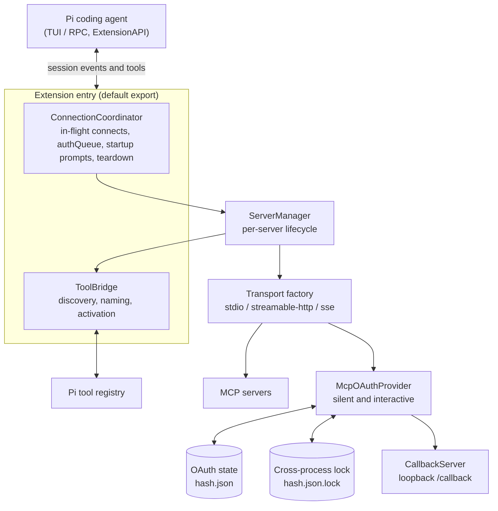
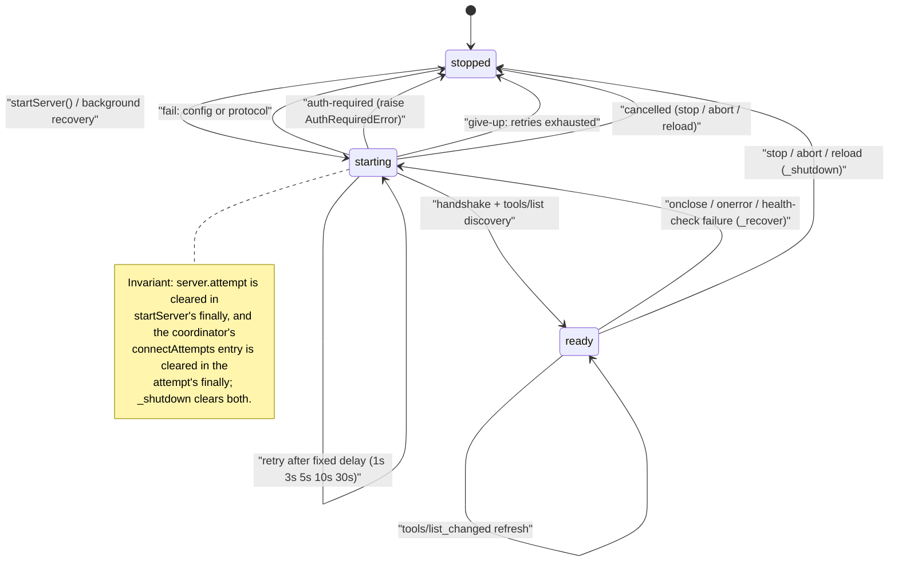
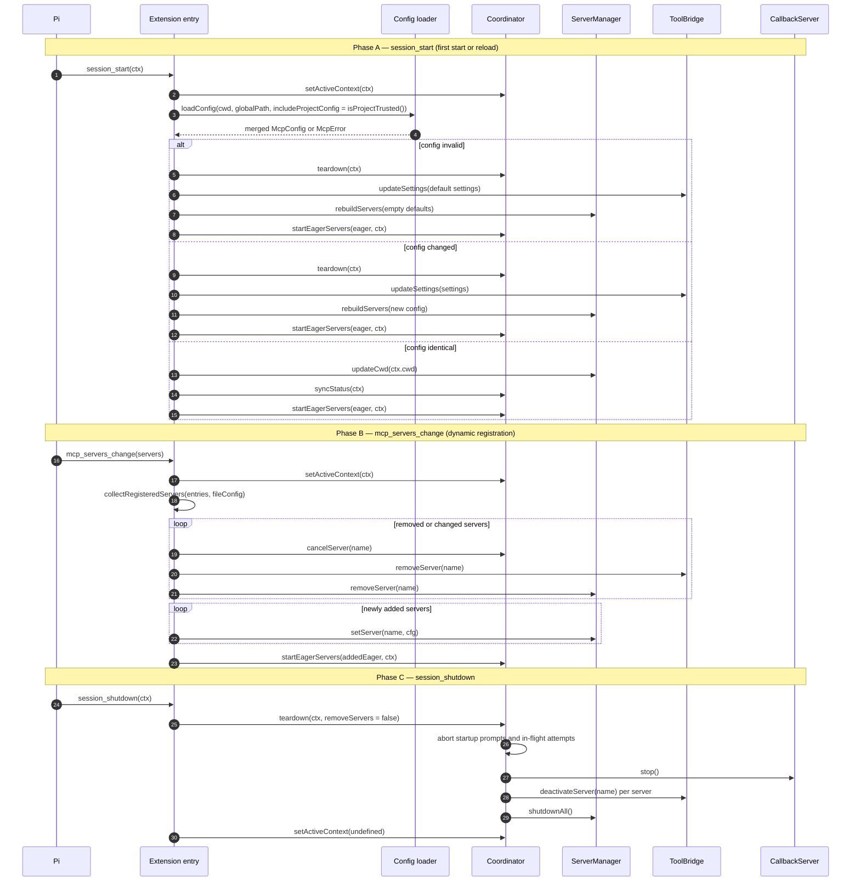
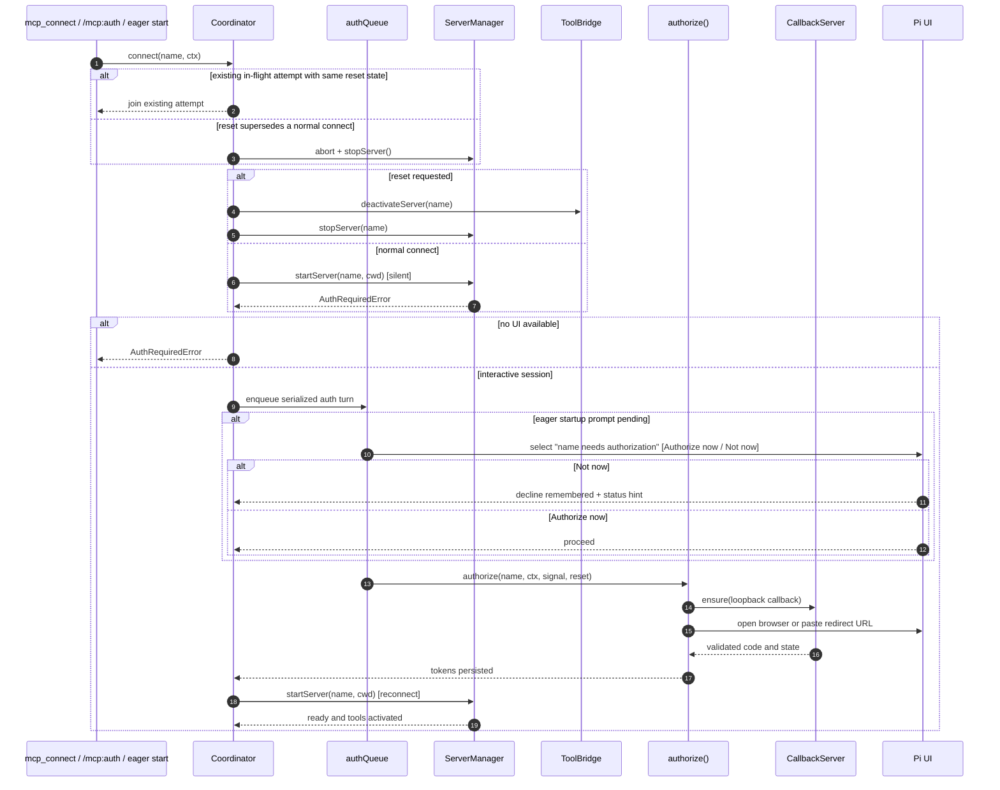
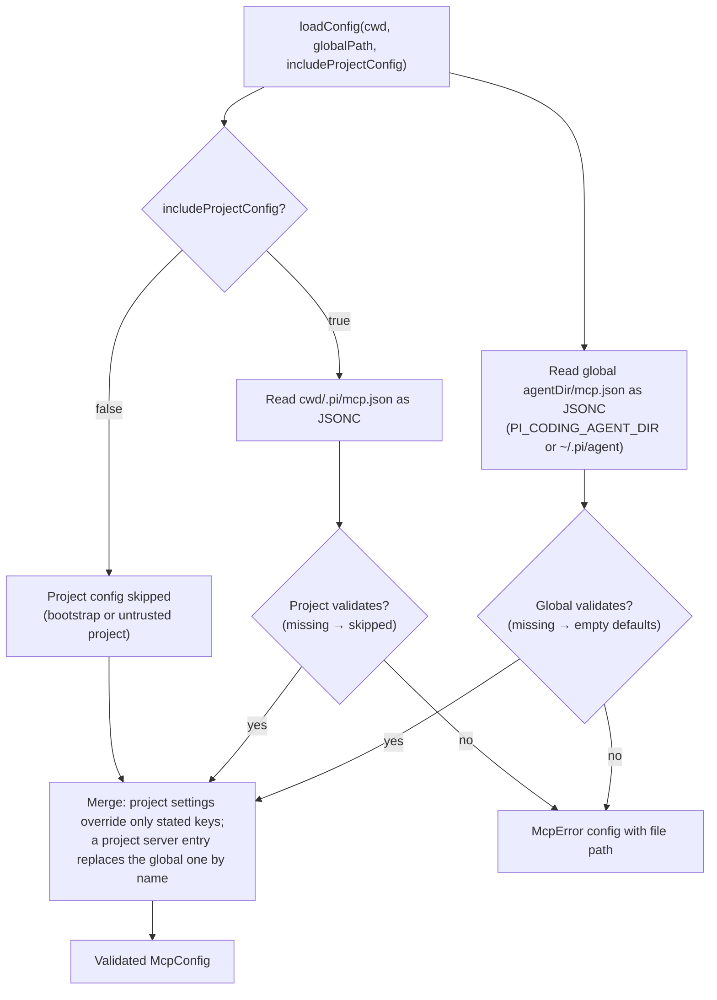

# Architecture

A behavioral overview of how the pi-mcp-extension runtime fits together. This page
describes **responsibilities and flows**, not file names — the module that owns each
piece is listed in the [AGENTS.md Repository map](../AGENTS.md#repository-map). Class and
function names are used directly; everything here is checked against the current `main`
branch, and the invariants called out in [AGENTS.md](../AGENTS.md) are cited where they
apply.

The extension has no build step: Pi loads the entry module as TypeScript directly. The
entry wires four collaborators — a **connection coordinator**, a **server manager**, a
**tool bridge**, and an **OAuth provider** — around the Pi `ExtensionAPI`. Configuration,
credentials, and child processes are the only places that touch the filesystem, the
network, the clock, or PIDs; policy and transforms stay as pure functions.

---

## 1. Big picture

- The **entry** loads config, constructs the four collaborators, and registers
  `session_start` / `mcp_servers_change` / `session_shutdown`, the `/mcp*` commands, and
  the `mcp_status` / `mcp_connect` tools. It registers them even when bootstrap config
  loading fails, so a later `session_start` in another directory can still load a valid
  project config.
- **ServerManager** owns one 3-state lifecycle per configured server and hands each
  connection to a transport built by the **transport factory**.
- **ToolBridge** turns `tools/list` into Pi tools and keeps them active/inactive as the
  server connects and disconnects.
- **McpOAuthProvider** is the SDK `OAuthClientProvider`. It reads and writes per-server
  state on disk and is serialized against other Pi processes by a lock file. The
  **CallbackServer** is a loopback HTTP listener used only by the interactive flow.

---

## 2. Server lifecycle

Each server is one of `stopped`, `starting`, or `ready`. `startServer()` moves it to
`starting` and runs `_connect()`; readiness means the MCP handshake **and** `tools/list`
discovery both succeeded, not just the handshake.

Failure handling is classified by a pure `classifyConnectFailure()` before it decides
what to do:

- **cancelled** — an `AbortSignal` fired or an `AuthCancelledError`; rethrow, no retry.
- **retry-corrupt-state** — the OAuth state file was corrupt and already backed up and
  removed by the provider; retry once immediately without consuming a retry slot.
- **auth-required** — `AuthRequiredError`, or a genuine 401 (during `initialize` and
  `tools/list`) / 403 `insufficient_scope`; invalidates stale tokens when applicable and
  raises `AuthRequiredError` so the coordinator can offer interactive authorization.
- **fail** — a fast-fail `config` or `protocol` `McpError`; no retry.
- **give-up** — `retryCount >= maxRetries`; wrap in an `McpError` (`timeout` or
  `connection`).
- **retry** — wait `RETRY_DELAYS_MS[retryCount]` (capped at the last entry) and reconnect.

While `ready`, three independent recovery paths exist:

- `notifications/tools/list_changed` → `ToolBridge.refreshTools()` re-registers the
  server's tools and deactivates ones the server no longer advertises.
- an opt-in **health check** timer pings at `healthCheckIntervalMs`; pings never overlap,
  each is time-bounded by the effective timeout, and a failure triggers `_recover()`.
- an unexpected transport close (`client.onclose`) or a stream error (`client.onerror`)
  triggers `_recover()`; deliberate closes abort the signal first and are ignored.

`_recover()` shuts the server down, bumps its `generation`, and reconnects on a
microtask; the generation guard prevents a stop during cleanup from being resurrected.
`_shutdown()` aborts the controller, clears the retry and health timers, resets `state`,
deactivates tools, closes the client, and — for stdio — runs
`ensurePidTerminated()` (SIGTERM → bounded wait → SIGKILL) and then
`destroyStdioStreams()`.

`ensurePidTerminated()` snapshots the child's descendant tree first
(`/proc/<pid>/task/*/children` on Linux, `ps -A -o pid=,ppid=` on other POSIX systems — e.g. an
`npx`/`npm exec`/`uvx`/`sh -c` wrapper that spawns the real server as a grandchild) and signals
it deepest-generation-first, so a wrapper death cannot re-parent a still-running server out of
reach. Windows has no portable parent/child enumeration, so it keeps single-PID termination.
`destroyStdioStreams()` then destroys the child's `stdout`/`stderr` read ends: a survivor that
inherited those pipes would otherwise keep the `'close'` event from ever firing and stall
`StdioClientTransport.close()` for its full 2 × 2,000ms escalation budget. Both
`_cleanupFailedConnect()` and `_shutdown()` go through `_terminateStdioTree()`, so a timed-out
handshake and an explicit stop behave identically.

---

## 3. Session events

`session_start` runs once per session switch and distinguishes a first start from a
reload by comparing the freshly loaded config against the in-memory one.

Key behaviors:

- **Project trust.** `includeProjectConfig` is `ctx.isProjectTrusted()` on
  `session_start`; bootstrap and untrusted projects never read `<cwd>/.pi/mcp.json`.
- **Invalid config** still tears down the previous session's servers, tools, prompts,
  and status, then rebuilds from empty defaults rather than leaving stale state active.
- **Config changed** tears everything down, applies `ToolBridge.updateSettings`, and
  rebuilds the server map from the new config.
- **Config identical** still refreshes roots: `ServerManager.updateCwd()` notifies ready
  servers whose `cwd` changed (root URIs are `pathToFileURL(cwd).href`) and re-syncs the
  status footer.
- **`mcp_servers_change`** reconciles dynamically registered servers: removed/changed
  ones are cancelled and dropped; new ones are added and started eagerly if configured.
- **Teardown** (`coordinator.teardown`) aborts startup prompts, aborts and awaits in-flight
  connect attempts, stops the callback server, deactivates (session reload) or removes
  (config change) each server's tools, and calls `shutdownAll()`. `session_shutdown`
  passes `removeServers: false` so tools stay registered but inactive.

---

## 4. Connect and auth coordination

The coordinator serializes the concurrency-sensitive parts: concurrent connect requests
join one in-flight attempt (a `--reset` supersedes a normal connect and shares one
pending reset), and interactive OAuth runs one server at a time through a promise-chain
`authQueue`.

Details:

- A silent connect never opens a browser or runs Dynamic Client Registration. If it
  ends in `AuthRequiredError` and the server is configured for OAuth, the coordinator
  offers interactive authorization.
- Interactive authorization goes through `authorize()`, which acquires the auth lock,
  optionally `--reset`s credentials, starts the callback server, generates the CSRF
  state, discovers the protected-resource challenge, and drives the SDK `auth()` flow.
  See [OAUTH.md](../OAUTH.md) for the browser and paste-back details.
- Eager OAuth servers that need authorization during `session_start` are queued behind
  `authQueue` and prompt sequentially (`Authorize now` / `Not now`) in an interactive
  session. Choosing **Not now** records the decline for the rest of the session and
  leaves a `run /mcp:auth <name>` status hint.
- `cancelServer()` aborts the startup prompt and the in-flight attempt; an aborted
  waiter wakes immediately and rejects with `AuthCancelledError` without breaking the
  queue for later waiters.

---

## 5. Config loading and project trust

Behavior:

- **Bootstrap** calls the loader with `includeProjectConfig: false`, so the global
  file is read but a project file never is, before trust is resolved.
- **`session_start`** sets `includeProjectConfig` from `ctx.isProjectTrusted()`.
- **JSONC.** `//` and `/* ... */` comments are stripped in a single pass that preserves
  newlines, so `JSON.parse` error messages keep accurate line numbers.
- **Merge.** Project `settings` override only the keys they state (project settings
  carry no defaults), and a project server entry replaces the global entry with the same
  name entirely. If neither file exists, `loadConfig()` returns an empty valid config
  with default settings. There is no deep merge and **no `${VAR}` interpolation** —
  config is WYSIWYG.
- **Pi 1.3.0 project overrides.** An entry without `command`, `url`, `type`, or
  `transport` is a partial override of the global server with the same name, exactly as
  Pi's `/mcp` writes it (`{ "internal-tools": { "enabled": false } }`). The override is
  applied to the **raw** global entry before validation, so the global `command`/`url`,
  headers, and OAuth config are kept and the project only changes `enabled`,
  `lifecycle`, `exposure`, or `toolExposure` (`exposure` / `toolExposure` are Pi-native
  and ignored here). An override with any other key, or for a name no global file
  defines, is a config error naming the file and the server.
- **Pi 1.x aliases** are normalized before validation: `type` → `transport`, `"http"` →
  `"streamable-http"`, `oauth` → `auth`, `timeout` (seconds) → `requestTimeoutMs`, and
  `enabled: false` → `lifecycle: "lazy"` (a disabled server never joins the eager set,
  even when `lifecycle` says `eager`). Defaults: `transport` is `stdio` (or
  `streamable-http` when `url` is set), `lifecycle` is `lazy` (eager for
  extension-registered servers unless `enabled: false`), `toolPrefix` is `mcp`,
  `requestTimeoutMs` is `30000`, and `maxRetries` is `5`.
- **Load-time validation.** `toolPrefix` must match `^[a-zA-Z][a-zA-Z0-9_]*$`; `auth` is
  rejected on `stdio`; `auth.provider` (Pi's `/login` provider token, which this
  extension cannot forward) is rejected instead of being silently downgraded to OAuth;
  `auth.redirectUrl` (including the `callbackUrl` / `callbackPort` aliases) is validated
  when the config loads; `stdio` requires `command` and URL-based transports require
  `url`; `cwd` is stdio-only. Failures are `McpError` of kind `config` and include the
  file path.
- **Extension-registered servers** from `pi.registerMcpServer()` are collected on
  bootstrap and on every `mcp_servers_change`; a same-named `mcp.json` entry takes
  precedence.
- **Provenance.** `loadConfigWithOrigins()` returns the merged config plus the winning
  file origin per server (`global` or `project`); the entry merges in the registered
  extension server names (`withExtensionServers`) and keeps that record for the current
  session. `/mcp <name>` and `mcp_status` report it as `Source` / `source`, and a
  skipped project config renders as `Project config: not loaded (<path>)` instead of
  silently missing servers. `loadConfig()` remains the thin wrapper that returns only
  the merged config.

---

## 6. Credential storage

OAuth credentials are stored per server, keyed by a hash of the server name, inside the

```mermaid
flowchart TD
    subgraph WritePath["Write path — acquireAuthLock and saveState"]
        W1{"Another process holds<br/>hash.json.lock?"}
        W2["acquireAuthLock: create 0600 with<br/>pid, hostname, nonce, createdAt"]
        W3{"30s heartbeat stale (>90s)<br/>or same-host PID dead?"}
        W4["AuthLockError, caller retries later"]
        W5["loadState + update state:<br/>verify serverUrl and issuer binding"]
        W6["saveState: write temp file 0600 then rename;<br/>chmod dir 0700 and file 0600"]
        W1 -->|no| W2
        W1 -->|yes| W3
        W3 -->|stale: nonce-verified reclaim| W2
        W3 -->|not stale| W4
        W2 --> W5
        W5 --> W6
    end

    subgraph ReadPath["Read path — loadState"]
        R1["read hash.json"]
        R2{"parse or schema<br/>validate fails?"}
        R3["rename to hash.json.corrupt-timestamp<br/>and raise McpError config"]
        R4{"stored serverUrl<br/>matches expected?"}
        R5["return empty state;<br/>another origin is never reused"]
        R6["return state:<br/>clientInfo, tokens, discoveryState"]
        R1 --> R2
        R2 -->|yes| R3
        R2 -->|no| R4
        R4 -->|no| R5
        R4 -->|yes| R6
    end

    subgraph RefreshPath["Single-use refresh — invalidateCredentials(tokens)"]
        T1["Refresh rejected → reload hash.json once"]
        T2{"Peer process already<br/>rotated tokens on disk?"}
        T3["Adopt peer tokens in memory<br/>instead of deleting"]
        T4["Clear stored tokens under lock<br/>and raise AuthRequiredError"]
        T1 --> T2
        T2 -->|yes| T3
        T2 -->|no| T4
    end
```

auth directory (`<agent dir>/mcp-auth/`, or `<storageDir>` when injected). The state file
is `<hash>.json`; the interactive lock is `<hash>.json.lock`.

Behavior:

- **Origin binding.** The state file records a canonical `serverUrl`. `loadState()`
  returns an empty state when the stored URL does not match the configured URL, so a
  project server that reuses a global server's name cannot inherit its tokens. A legacy
  file without `serverUrl` is also checked against the cached resource metadata.
- **Authorization-server binding.** The SDK's `issuer` is persisted and returned
  unchanged (including in silent mode and peer reloads); a stamped client is never
  re-bound to another issuer, and a config-supplied `client_secret` is never written to
  disk.
- **File safety.** Directories are created and forced to `0700`; files are written `0600`
  via a temp file plus `rename` (atomic on the same filesystem) and re-`chmod`ed.
- **Corrupt files.** A state file that fails schema validation is renamed to
  `<hash>.json.corrupt-<timestamp>` and raises an `McpError` of kind `config`; callers
  retry once so OAuth can proceed cleanly. A corrupt file for one server never breaks
  `mcp_status` for the others.
- **Interactive lock.** The lock file is created with `wx` and `0600` and holds a
  versioned JSON record (`pid`, `hostname`, `nonce`, `createdAt`). A 30s heartbeat
  updates its `mtime`; a lock is stale when the heartbeat is older than 90s or when it
  is on the same host and its PID is dead. Reclamation renames the candidate aside,
  verifies the nonce, then deletes it or restores a contender's fresh lock. A held lock
  that is lost mid-flow aborts the authorization with a retry error.
- **Refresh tokens are single-use.** Before invalidating tokens, the silent path reloads
  them from disk once: if a peer process already rotated them, it adopts the peer's
  tokens instead of deleting them. Interactive writes are coordinated through the lock.

---

## See also

- [AGENTS.md Repository map](../AGENTS.md#repository-map) — which module owns what.
- [CONTRIBUTING.md](../CONTRIBUTING.md) — setup, workflow, and the pre-merge smoke-test checklist.
- [OAUTH.md](../OAUTH.md) — the user-facing OAuth flow and troubleshooting.
- [README.md](../README.md) — configuration, commands, and MCP spec compliance.
